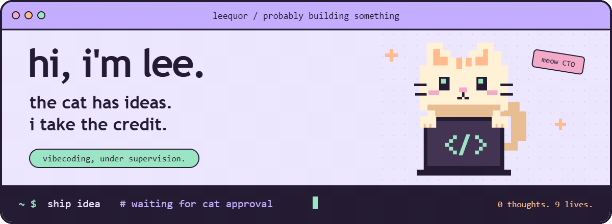

<p align="center">
  
</p>

<p align="center">
  
  
  
</p>

I'm **Alexander R. Campita**—Lee for short. A Computer Science student who likes
programming, databases, and solving problems by building useful things.

### education

**BS Computer Science** at **New Era University**, 2024–Present.

### Skills

| Area | What I use |
| :--- | :--- |
| Programming | Java, JavaScript |
| Databases | SQL |
| Tools and markup | Lucidchart, Eclipse, HTML |

### certificates

- [SQL and Relational Databases 101](https://courses.cognitiveclass.ai/certificates/3a69b0b78bea4b64bb3274db8eb260a0)
- [Oracle Cloud Infrastructure 2025 Certified Foundations Associate](https://catalog-education.oracle.com/pls/certview/sharebadge?id=8A2D359385E40E5A935A39C24CFB9CCC412A84C13AFAF8BBE3378A274176B025)
- [Oracle Data Platform 2025 Certified Foundations Associate](https://catalog-education.oracle.com/ords/certview/sharebadge?id=2FC300A6ACBECDC49C50C65F8D70234B088E75B373E7A7CE79604C39AE8579C5)
- [Oracle Cloud Infrastructure 2025 Certified AI Foundations Associate](https://catalog-education.oracle.com/ords/certview/sharebadge?id=A95CB5C18E05BA91F816DA5263863FBC3735A21257479B5BB5EA32D0D953EA70)

### things that escaped localhost

| Project | What it is |
| :--- | :--- |
| [MediHeal](https://github.com/leequor/mediheal-his-complete) | A hospital system demo. The patients have more patience than my debugger. |
| [Patchwork](https://github.com/leequor/patchwork-rebuilt) | A repair-shop operations desk. “Just a quick fix” developed a backstory. |

[wander through my repos](https://github.com/leequor?tab=repositories)

### let's connect

Ideas, collaborations, or a second opinion on whether the cat is qualified to be CTO:

- LinkedIn: [Alexander R. Campita](https://www.linkedin.com/in/alexander-campita-7b34b739a)
- Email: [alexandercampita521@gmail.com](mailto:alexandercampita521@gmail.com)

<details>
<summary>open the forbidden documentation 🐾</summary>

<br>

```text
lee@localhost ~ % cat workflow.txt

  cat gets an idea
  explain it to the AI
  explain it again, with feeling
  build → test → fix → “one more small change”
  ask the cat for approval
  cat walks away
  ship anyway, take the credit
```

```text
       /\_/\
      ( o.o )   i reviewed your code.
       > ^ <   the box it came in was excellent.
```

**Frequently avoided questions**

- **What's your stack?** Whatever makes the idea work. Plus one cat.
- **Do you use AI?** Yes. We take turns being confidently wrong.
- **Why is this function called `final_final_v3`?** Archaeology is still ongoing.
- **Can we collaborate?** Sure. Bring an idea. The cat will schedule a nap.

</details>

---

<p align="center">
  <sub>if you've read this far, you're legally the cat's second favorite human.</sub>
</p>
